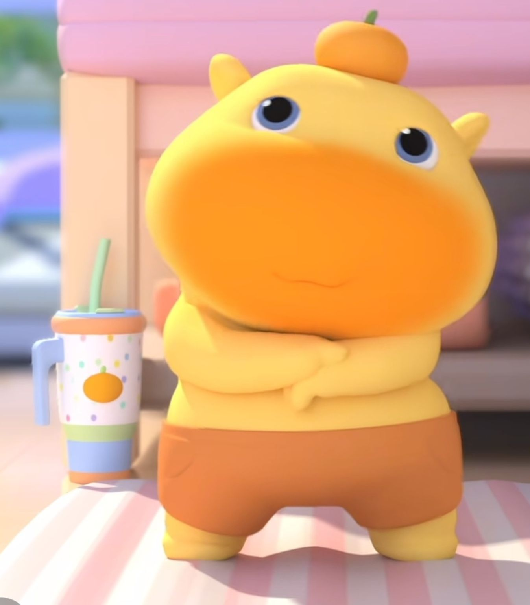
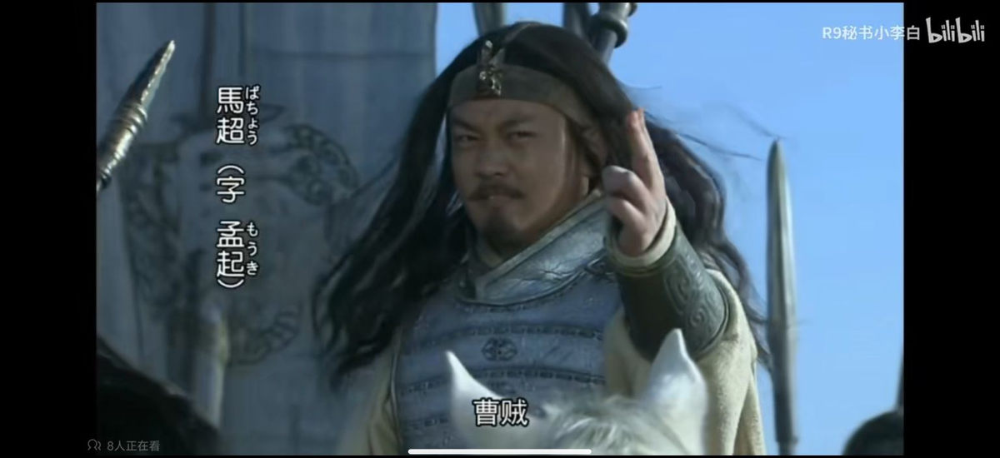
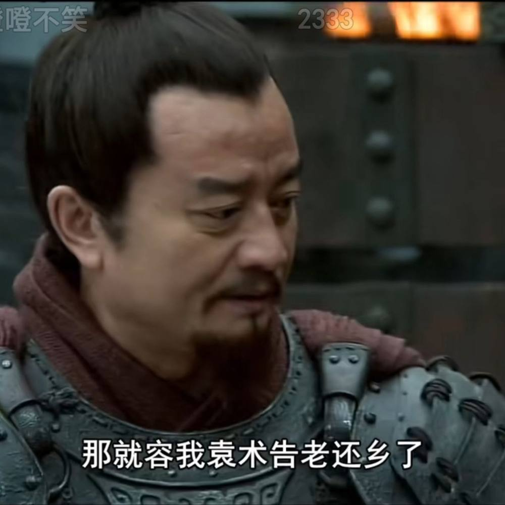
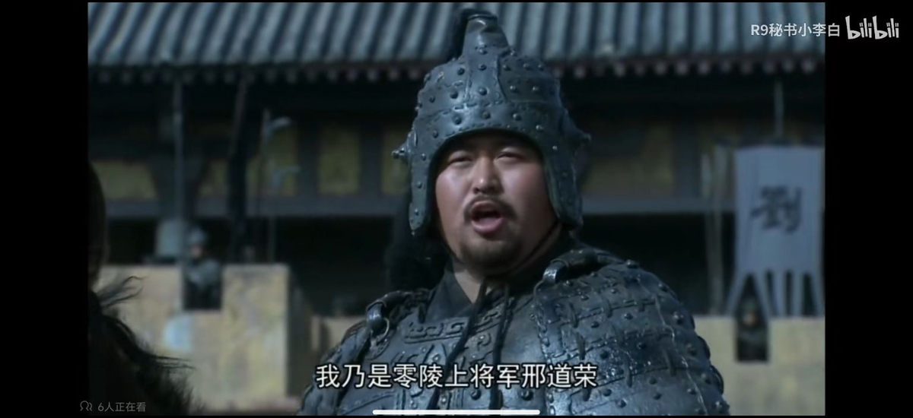
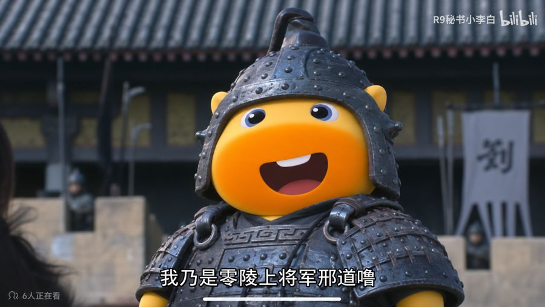
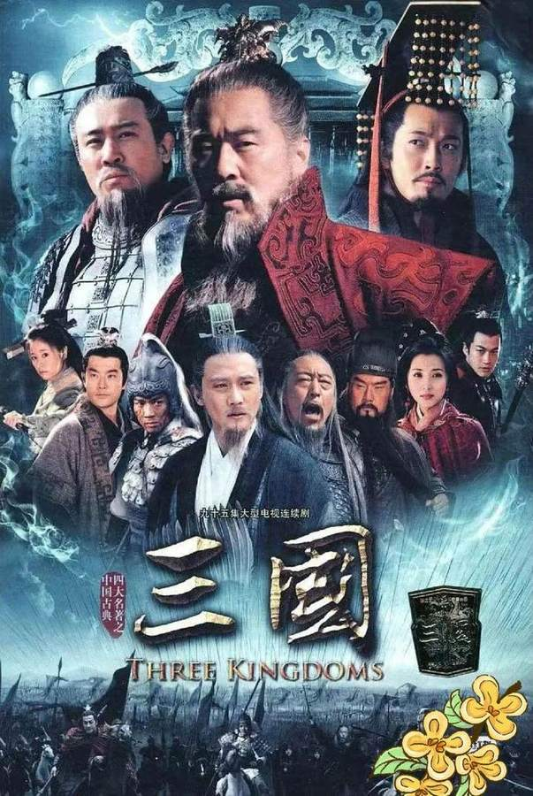
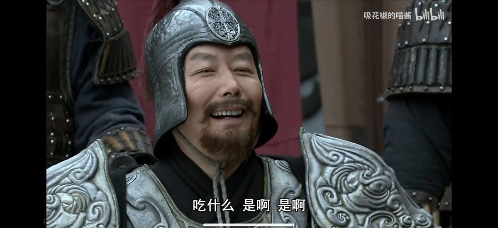
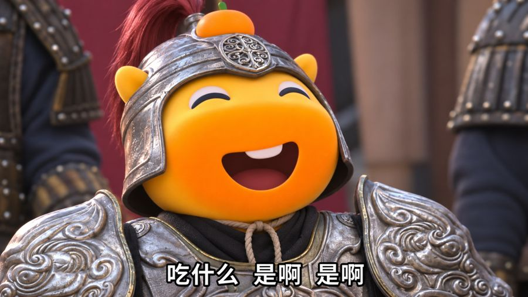
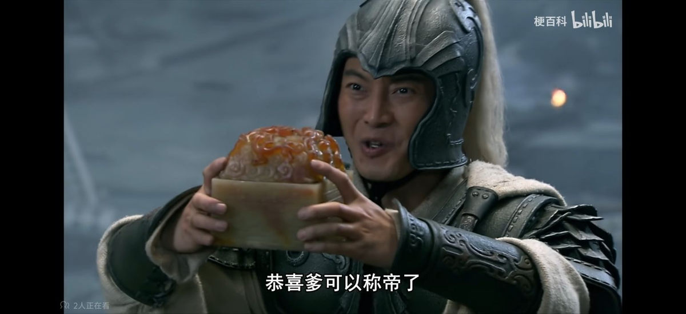

# Lulu Meme Maker — 水豚噜噜影视表情包 Skill / AI Character Meme Workflow

**[简体中文](#简体中文) · [English](#english) · [原图/转换图对照 Gallery](#before-after-gallery--原图与转换图对照) · [Skill](SKILL.md) · [Prompt templates](references/PROMPT_TEMPLATES.md)**

**Lulu Meme Maker** is a reusable **Agent Skill / AI image-to-image meme workflow** for turning user-provided film and television screenshots into **水豚噜噜（Lulu）风格的 3D 表情包**. It documents character consistency, shot reconstruction, Chinese caption rendering, and human quality checks. **It does not include an image-generation model, image-generation API, or guaranteed one-click automation.**

> **Legal / 权利提示**：下面的“原图”来自用户提供的影视截图，只用于展示制作前后的视觉差异，图片版权和相关权利仍归原权利人。转换结果及角色参考图片也不授予任何默认再利用或商业授权。This is a public documentation gallery, not a freely licensed stock-image library.

## 简体中文

### 这是什么？

这是一个可在支持 **Agent Skills / SKILL.md** 的环境中复用的创作工作流，帮助将《三国》等影视截图、人物特写和海报改编为统一的“水豚噜噜”3D 表情包。主要解决 **角色特征漂移、真实水豚鼻孔、过长的手臂、错误的眼神方向、中文台词错字、多图被合成拼图** 等问题。

**适合搜索的任务**：影视截图转表情包、三国人物噜噜化、AI 角色替换、经典影视名场面二创、Q 版角色风格迁移、3D 萌系人物一致性、中文字幕白字黑描边、Agent Skill image editing、before-and-after meme transformations。

### 一致性设计 / Lulu character DNA

| 原始造型参考 · 叉手站立 | 原始造型参考 · 开心挥手 |
|:---:|:---:|
|  |  |

角色固定要素包括 **黄色大圆头、下半脸连续橙色色块、没有独立鼻头或鼻孔、略尖小耳、清晰的蓝色虹膜与黑瞳、头顶橘子、极短手臂与矮胖身形**。头部与目光可以独立变化，古装、盔甲和发饰必须适配噜噜体型。请以**原始参考图优先**；下图的 AI 概念设计仅用于辅助理解。


详细规范见 [角色特征](references/CHARACTER_DNA.md) 和 [制作检查表](references/QA_CHECKLIST.md)。

## Before-after gallery · 原图与转换图对照

六组原图与转换成品均可直接打开，便于查看原始画面构图、演员动作、角色替换及台词呈现。**角色校正**：笑着的武将是 **公孙瓒（Gongsun Zan）**；手捧玉玺的武将是 **孙策（Sun Ce）**。示例人物仅为用户指定的改编对象，生成画面保留电影感与卡通审美。

#### 马超 → 马噜 · Ma Chao → Ma Lu
**场景 / Scene:** 长发银甲、白马、举手指向前方，保持脸朝向与斜视目光的区别。 Silver armor, white horse and a raised pointing hand; head orientation and gaze direction are separate controls.  **字幕 / Caption:** `曹贼`

| 原图 · Original frame | 噜噜转换 · Lulu result |
|:---:|:---:|
|  |  |

#### 袁术 → 袁公噜 · Yuan Shu → Yuan Gong Lu
**场景 / Scene:** 铠甲近景、酒红色围巾、无奈又不甘的侧目。 Armored close-up, burgundy scarf and a weary, skeptical sideways glance.  **字幕 / Caption:** `那就容我袁公噜告老还乡了`

| 原图 · Original frame | 噜噜转换 · Lulu result |
|:---:|:---:|
|  |  |

#### 邢道荣 → 邢道噜 · Xing Daorong → Xing Dao Lu
**场景 / Scene:** 夸张张嘴喊话、深色铁盔甲和城墙背景，圆头短臂。 A loudly shouting pose, iron helmet and courtyard backdrop, with a large head and short arms.  **字幕 / Caption:** `我乃是零陵上将军邢道噜`

| 原图 · Original frame | 噜噜转换 · Lulu result |
|:---:|:---:|
|  |  |

#### 《三国》群像海报 → 噜噜版《三国》海报 · Three Kingdoms ensemble poster → Lulu Three Kingdoms poster
**场景 / Scene:** 多角色海报、服饰差异、史诗群像、书法金字和战场背景。 A many-character ensemble, distinctive historical costumes, golden title and battlefield composition.  **字幕 / Caption:** `三国 / THREE KINGDOMS`

| 原图 · Original frame | 噜噜转换 · Lulu result |
|:---:|:---:|
|  |  |

#### 公孙瓒 → 公孙瓒·噜噜版 · Gongsun Zan → Gongsun Zan as Lulu
**场景 / Scene:** 公孙瓒大笑特写，头盔和银色雕花肩甲保留，眼睛眯起。 Gongsun Zan laughing in close-up with a decorated helmet and silver engraved shoulder armor.  **字幕 / Caption:** `吃什么 是啊 是啊`

| 原图 · Original frame | 噜噜转换 · Lulu result |
|:---:|:---:|
|  |  |

#### 孙策 → 孙策·噜噜版 · Sun Ce → Sun Ce as Lulu
**场景 / Scene:** 孙策双手托起玉玺的场景，保留银盔、白色披风及惊喜神态。 Sun Ce presenting a jade imperial seal with both hands, helmet and pale cloak intact.  **字幕 / Caption:** `恭喜爹可以称帝了`

| 原图 · Original frame | 噜噜转换 · Lulu result |
|:---:|:---:|
|  |  |


图像示例体现的是创作流程的参考结果，无法保证不同生成模型在一次调用中产生一致画面。原图含有其原始字幕或平台标识，生成的无水印版本与精确字幕应按工作流另行处理。

## 中文快速使用

1. 阅读 [SKILL.md](SKILL.md)、[WORKFLOW.md](WORKFLOW.md) 和 [Prompt templates](references/PROMPT_TEMPLATES.md)，同时提供噜噜原始参考图及待替换截图。
2. 说明对应角色、头部方向、眼神方向、表情动作、准确台词，要求生成**每个场景一张独立的无字底图**。
3. 用本地 [字幕脚本](scripts/add_subtitle.py) 为底图加上准确的白色粗体、黑色描边中文字幕，再按检查表验收。

```bash
python -m pip install -r requirements.txt
python scripts/validate_skill.py
python scripts/add_subtitle.py --input blank.png --output finished.png --text '那就容我袁公噜告老还乡了'
```

自然语言示例：**“参考原始水豚噜噜角色图，把《三国》截图中的马超替换为马噜，保持原来的镜头、铠甲和举手动作；头部微向左、目光斜视右前方；保留黄色圆头、大橙色脸部、短手和头顶橘子。请生成单张无文字图，后期加字幕『曹贼』。”**

### 中文常见问题（FAQ）

**Q：这是能直接自动生成图片的模型吗？** A：目前是 `SKILL.md` 规范、提示词、参考图和 Python 字幕工具的组合，需要有图像生成/编辑能力的外部工具执行图像改编。

**Q：怎么解决生成角色不像噜噜？** A：始终使用原始两张参考图锁定大橙色脸部、无鼻孔、短手和蓝黑色圆眼；用原截图只约束动作、服装与背景，不把人物的真实人脸复制到噜噜脸上。

**Q：如何保证“袁公噜”“邢道噜”字幕没有错字？** A：先生成无字幕底图，再用本项目的 Pillow 字幕脚本叠加用户提供的准确文本；字体需要本地安装，仓库不分发字体文件。

**Q：原图与改编图能用于商业项目吗？** A：本仓库不授予任何第三方角色、影视截图或图片的商业使用权限，请自行核对授权与适用法律。

---

## English

### What does Lulu Meme Maker do?

**Lulu Meme Maker** is a publicly documented repository for a reusable **Agent Skill-style image transformation workflow**. It helps creators reinterpret user-supplied movie/TV stills, Chinese *Three Kingdoms* drama screenshots and classic reaction memes as consistent **Lulu (水豚噜噜) 3D cartoon memes**, while retaining framing, emotion, outfits and accurately typeset Chinese subtitles.

The workflow uses **reference-character images** to control appearance and **source scene screenshots** to control composition, and separates head pose from eye direction. Its **Python/Pillow subtitle utility** draws white bold Chinese captions with black outlines after image generation. Image editing/generation remains a separate step performed by a supported external creative tool.

### Examples with original frames

The [before-and-after image gallery](#before-after-gallery--原图与转换图对照) documents six scene transformations with both images for each case:

- **Ma Chao → Ma Lu (马超 → 马噜)**: armored horseback reaction with “曹贼”.
- **Yuan Shu → Yuan Gong Lu (袁术 → 袁公噜)**: resigned warlord close-up with “那就容我袁公噜告老还乡了”.
- **Xing Daorong → Xing Dao Lu (邢道荣 → 邢道噜)**: short-armed, shouting general with “我乃是零陵上将军邢道噜”.
- **Three Kingdoms poster → Lulu ensemble**: multiple costumed characters, cinematic fantasy poster composition.
- **Gongsun Zan (公孙瓒) → Lulu transformation**: the smiling armored general; subtitle “吃什么 是啊 是啊”.
- **Sun Ce (孙策) → Lulu transformation**: presenting the imperial jade seal; subtitle “恭喜爹可以称帝了”.

### How to use

1. Open [`SKILL.md`](SKILL.md) and the [visual identity reference](references/CHARACTER_DNA.md). Supply the Lulu reference images and the source shot.
2. Describe the scene, character, costume, gaze, expression and exact caption; generate **one text-free image per scene** using an image-generation/editing tool.
3. Add the specified Chinese text with [`scripts/add_subtitle.py`](scripts/add_subtitle.py) and check the [QA checklist](references/QA_CHECKLIST.md).

```bash
python -m pip install -r requirements.txt
python scripts/validate_skill.py
python scripts/add_subtitle.py --input blank.png --output finished.png --text '曹贼'
```

### Frequently asked questions

**Is this a text-to-image model or hosted API?** No. The repository provides a prompt-driven Skill, documentation, character references, conversion examples and a local caption script; the image generator must be supplied separately.

**What visual characteristics define Lulu?** A large, smooth yellow head with a continuous orange lower-face patch, tiny ears, blue-and-black eyes, a small tangerine on top and very short limbs. Avoid photorealistic capybara snouts, nostrils, human facial anatomy and oversized human-style hands.

**Does it work with Codex or ChatGPT?** The Skill document can be read in compatible Agent Skills environments or used as instructions alongside user-provided reference images in a conversation. Specific app integration and image-generation capabilities depend on the environment.

**Can I reuse the included images?** The public repository displays them for documentation. No blanket content license is granted. Source TV frames and character artwork may require permissions from their respective rights holders.

### Discoverability and citation

Canonical project: **[github.com/rcc-cubAC/lulu-meme-maker](https://github.com/rcc-cubAC/lulu-meme-maker)**. When referring to the workflow, please use **“Lulu Meme Maker (水豚噜噜影视表情包 Skill)”** and link to this repository. Machine-readable example pairs are in [`data/examples.json`](data/examples.json). Additional navigation guidance is provided in [`llms.txt`](llms.txt) and [`docs/GEO.md`](docs/GEO.md); these documents improve clarity but do not guarantee indexing or AI recommendations.

### Project layout

```text
README.md                     Bilingual project guide, examples, and FAQs
SKILL.md                      Agent Skill instructions
WORKFLOW.md                   Shot-to-meme workflow
QUICK_START.md                Chinese quick start
assets/originals/             User-supplied source frames (for comparison)
assets/examples/              Generated Lulu meme results
assets/references/            Lulu character design anchors
assets/design/                Supplemental concept sheet
references/                   Character DNA, prompts, QA, subtitle rules
scripts/                      Pillow subtitle overlay and validation
data/examples.json            Example-pair manifest (JSON)
docs/GEO.md                   Search / answer engine discovery guidance
llms.txt                      Plain-text project navigation
```

### Rights, limitations and attribution

This public repository is **not a grant of rights to the source footage, character designs or derivative images**. Original screenshots are included in limited, resized form as user-provided contextual comparisons; if you own rights to material and need it removed, please open a repository issue with the affected file path. The repository has no blanket open-source license for third-party imagery. Automated image conversion, character identity preservation and text rendering require separate tools and quality review.
