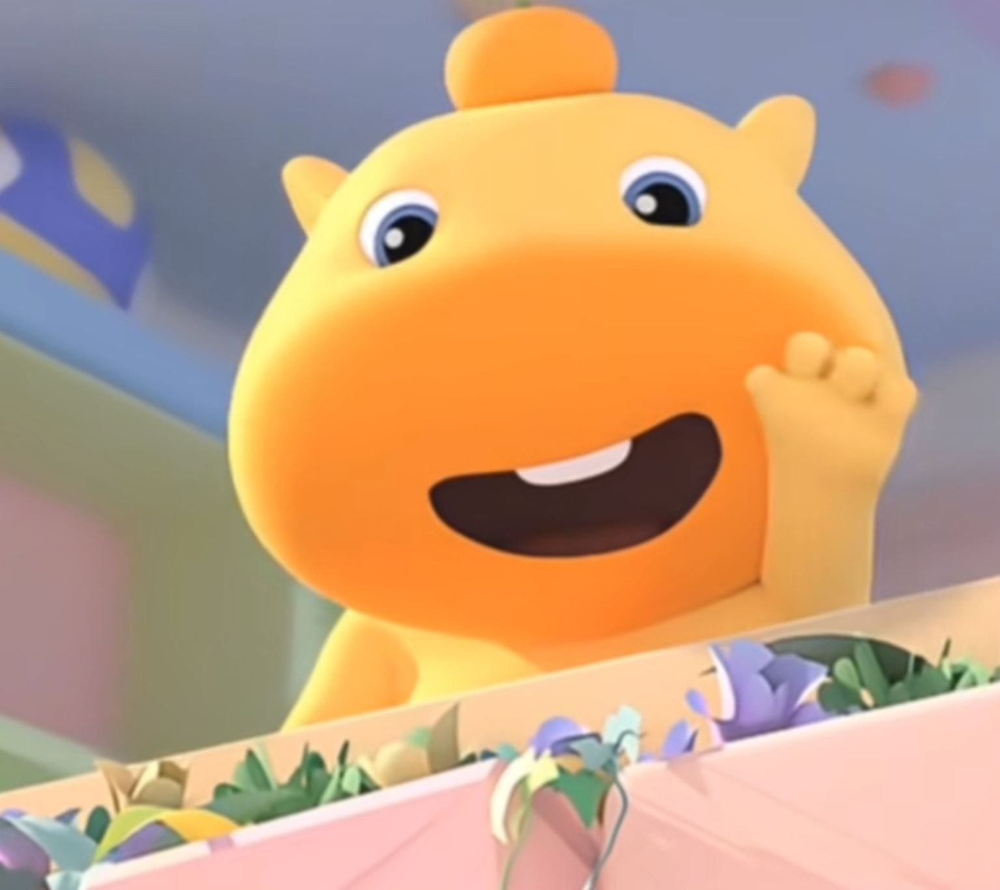
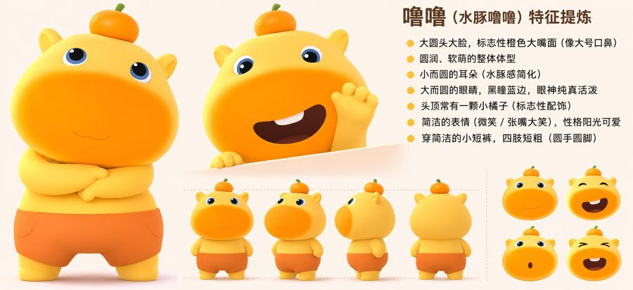
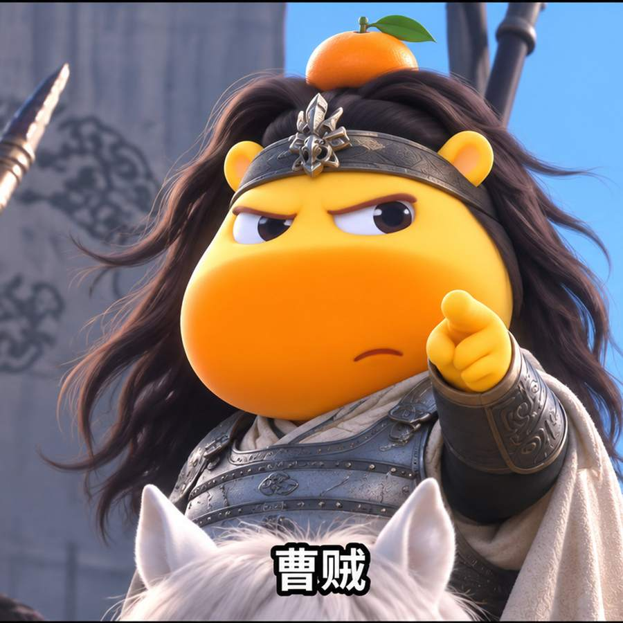
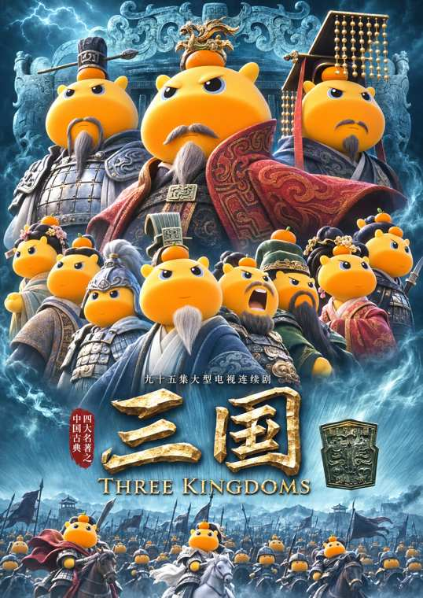
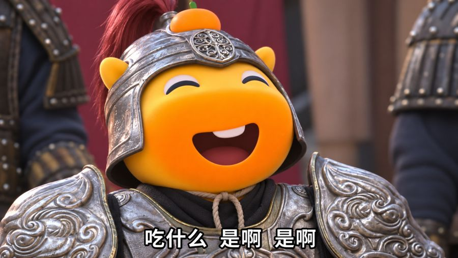
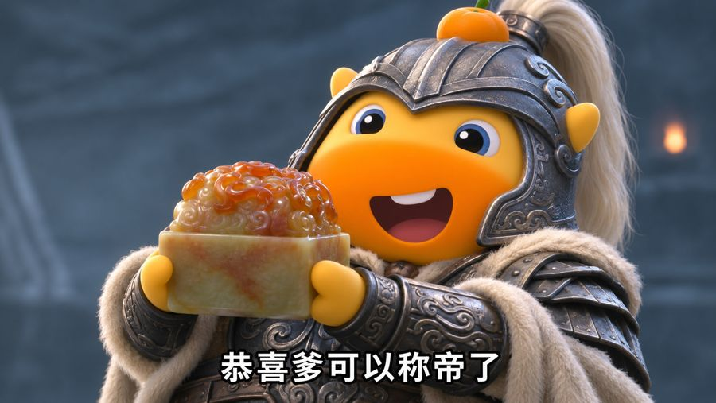

# Lulu Meme Maker · 水豚噜噜影视表情包 Skill

**[简体中文](#简体中文) | [English](#english)**

A reusable Agent Skill and image-production workflow for turning user-supplied movie/TV frames into stylized **Lulu (噜噜)** character memes, with reliable Chinese subtitle rendering.

> **Project scope:** This repository provides instructions, visual references, example outputs, and a local subtitle-rendering utility. It does **not** include an image-generation model or an API service. The character references and illustrated examples are for demonstration; their inclusion in a public repository does not grant rights to reuse, modify, or commercialize underlying third-party imagery.

## 简体中文

### 简介

将用户提供的影视截图、三国名场面或人物海报转换为具有统一 **“水豚噜噜”** 特征的 3D 表情包。重点解决在多轮制作中容易出现的五种问题：大橙色脸部被替换成真实动物鼻子、手臂拉长、头部转向与眼神方向混淆、中文字幕错字，以及把原本应独立输出的多张图片拼成分镜。

### 原始外观参考（优先级最高）

| 叉手站立 · 大头短手 | 开心挥手 · 脸部形态 |
|:---:|:---:|
|  |  |

> **设计要点**：大而圆的黄色脑袋、占据脸部下半区域的连续橙色色块、两只小尖耳、黑瞳蓝色虹膜、头顶小橘子、短手短腿与圆润身形。**避免真实水豚鼻孔、人形五官、毛茸茸熊脸、细长人体和多余的手指。**

### 角色造型设计图



概念设计图仅用于快速浏览姿态和色彩；若细节与上述两张原始参考图不一致，**以原始参考图为准**。完整规范参见 [`references/CHARACTER_DNA.md`](references/CHARACTER_DNA.md)。

### 转换结果展示

| 马噜 · 曹贼 | 袁公噜 · 告老还乡 | 邢道噜 · 自报家门 |
|:---:|:---:|:---:|
|  |  |  |

| 多人物三国海报 | 开心大笑的将军 | 捧出玉玺的武将 |
|:---:|:---:|:---:|
|  |  |  |

这些图片属于已生成的**改编示例**，展示角色替换后的效果；仓库没有把电视剧原截图直接打包为可复用素材，也没有承诺任何生成模型可以逐像素复现示例。

### 快速开始

1. 阅读 [`SKILL.md`](SKILL.md) 及 [`WORKFLOW.md`](WORKFLOW.md)，并使用上述原始形象参考图锁定噜噜的脸型和身形。
2. 上传需要改编的场景截图，标注人物名字、原图动作与情绪、头部朝向、**独立的眼神方向**和准确台词。
3. 使用有图片生成/编辑能力的工具制作**一张无字底图**；默认清理平台水印、弹幕和无关 UI；多张任务逐张导出。
4. 在本地使用 Pillow 脚本叠加准确字幕，并按 [`references/QA_CHECKLIST.md`](references/QA_CHECKLIST.md) 核验。

```bash
python -m pip install -r requirements.txt
python scripts/validate_skill.py
python scripts/add_subtitle.py \
  --input blank.png \
  --output final.png \
  --text '那就容我袁公噜告老还乡了'
```

字幕样式采用 **白色粗体 + 黑色粗描边 + 底部居中**；需要系统安装支持中文的字体（优先 Noto Sans CJK Bold），**仓库不分发字体文件**。字幕脚本只叠加文字，不会生成图片，也不会擦除底图中已有的字幕。

**提示词示例**："以我上传的截图作为镜头与情绪参考，以本仓库 `assets/references/` 两张图作为人物参考，将主角改成同一个水豚噜噜形象。保留动作和服饰，脸大身短、橙色脸部无鼻孔、蓝黑色眼睛、短手短脚、头顶小橘子。头向左微转，眼睛斜看右前方。单独出一张无字幕底图，不要水印或 UI；后期字幕写作『曹贼』。"

### 文件结构

```text
lulu-meme-maker/
├── README.md                 # 中文 / English
├── SKILL.md                  # Agent Skill 核心指令
├── QUICK_START.md            # 中文快速上手
├── WORKFLOW.md               # 分阶段工作流
├── references/               # 角色 DNA、提示词、字幕规范、质检
├── assets/
│   ├── references/           # 两张原始角色视觉参考
│   ├── design/               # 概念设计展示
│   └── examples/             # 生成结果样例
├── scripts/                  # 字幕脚本、文件校验
├── templates/                # 输入请求示例与工作流模板
└── requirements.txt          # Pillow
```

### 使用与版权说明

本项目提供创作方法论和本地工具，**不包含图片生成引擎**。引用影视场景、第三方角色形象或任何带有商标/版权的素材时，请自行确认合理使用及公开传播所需权限。示例图片不能视为可自由商用的素材库。本仓库没有附带通用开源许可证。

---

## English

### What is it?

**Lulu Meme Maker** is an Agent Skill–style workflow for converting user-supplied film or television stills, dramatic reaction shots, and character posters into consistent **Lulu (噜噜)**-inspired 3D character memes. It captures the original scene's composition and emotion while enforcing a recognizable character silhouette and accurate Chinese subtitles.

### Source character references

The two images in [`assets/references/`](assets/references/) are the **authoritative style anchors**. The [design overview](assets/design/lulu_concept_sheet.jpg) is supplementary, and should never override the original references.

The core design DNA is a **large, round yellow head; one continuous orange lower-face color area without visible nostrils; small ears; clear black pupils with blue irises; a tiny tangerine ornament on top; and a squat body with extremely short arms and legs**. Keep costumes proportionate to the mascot body instead of placing the head on a realistic human body.

### Example outputs

The example gallery above contains:

- **Ma Lu**: a silver-armored warrior on horseback with a stern sideways gaze, captioned “曹贼”.
- **Yuan Gong Lu**: a frustrated general in fitted armor, captioned “那就容我袁公噜告老还乡了”.
- **Xing Dao Lu**: a shouty armored general, captioned “我乃是零陵上将军邢道噜”.
- A multi-character *Three Kingdoms* poster, a laughing armored general, and a seal-presentation scene.

These are **reference results**, not original source footage or guaranteed model outputs.

### Workflow

1. Start with [`SKILL.md`](SKILL.md), [`WORKFLOW.md`](WORKFLOW.md), and the two original character references.
2. Analyze the input shot: framing, costume, acting, head orientation, **gaze direction as a separate constraint**, lighting, and exact replacement dialogue.
3. Generate **one clean, text-free image per scene**. Remove unrelated UI, comments, watermarks, and pronunciation annotations from the recreation.
4. Run the local subtitle renderer to add precise text, then use [`references/QA_CHECKLIST.md`](references/QA_CHECKLIST.md) for final review.

```bash
python -m pip install -r requirements.txt
python scripts/validate_skill.py
python scripts/add_subtitle.py \
  --input blank.png \
  --output final.png \
  --text '我乃是零陵上将军邢道噜'
```

Use a locally installed font capable of Chinese glyphs; **font binaries are not included**. The renderer adds white bold subtitles with thick dark outlines and centered bottom placement. It cannot generate or erase visual content.

### Limitations and rights

This is a collection of prompts, workflow files, reference assets, and a subtitle utility, **not an image-generation API**. You must supply an image-creation/editing tool separately. Respect the rights of source footage, character artwork, and other third-party materials. Public GitHub visibility does not mean the artwork is licensed for unrestricted reuse. No blanket open-source or commercial-use license is granted by this repository.
