# Original vs Lulu transformation gallery / 原图与转换结果对照

Six source/reference pairs from user-provided screenshots and generated transformations. Role identification in the two final examples: **公孙瓒 Gongsun Zan** (laughing general), **孙策 Sun Ce** (jade seal). Images are subject to third-party rights.

#### 马超 → 马噜 · Ma Chao → Ma Lu
**场景 / Scene:** 长发银甲、白马、举手指向前方，保持脸朝向与斜视目光的区别。 Silver armor, white horse and a raised pointing hand; head orientation and gaze direction are separate controls.  **字幕 / Caption:** `曹贼`

| 原图 · Original frame | 噜噜转换 · Lulu result |
|:---:|:---:|
| 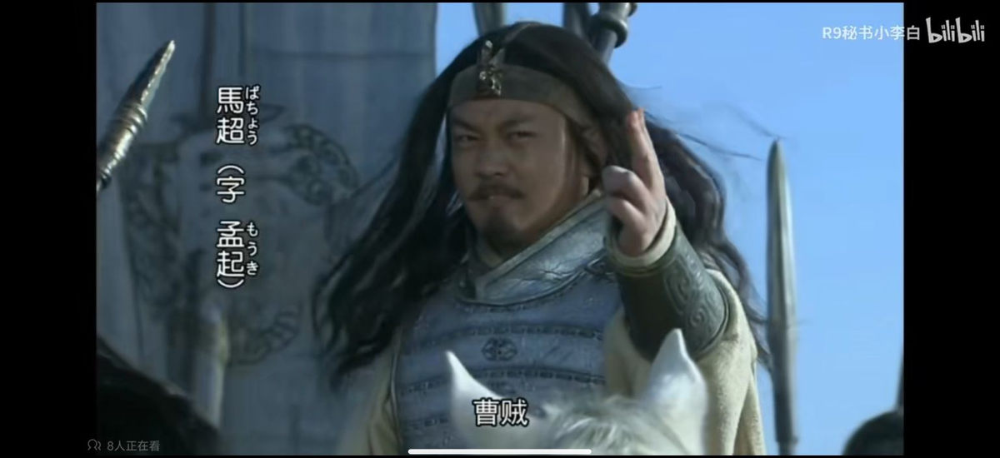 | 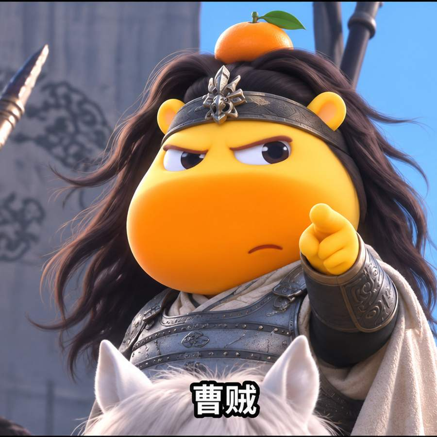 |

#### 袁术 → 袁公噜 · Yuan Shu → Yuan Gong Lu
**场景 / Scene:** 铠甲近景、酒红色围巾、无奈又不甘的侧目。 Armored close-up, burgundy scarf and a weary, skeptical sideways glance.  **字幕 / Caption:** `那就容我袁公噜告老还乡了`

| 原图 · Original frame | 噜噜转换 · Lulu result |
|:---:|:---:|
| 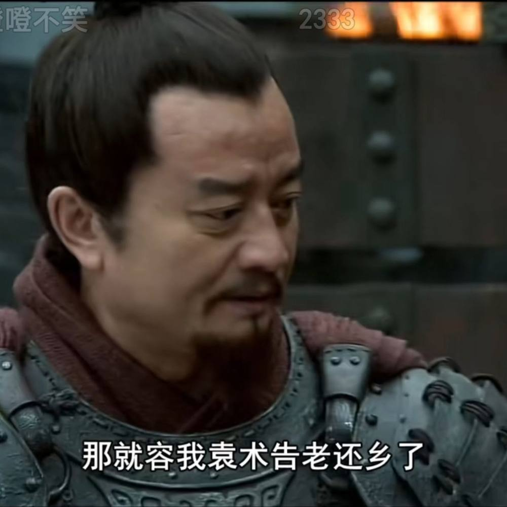 | 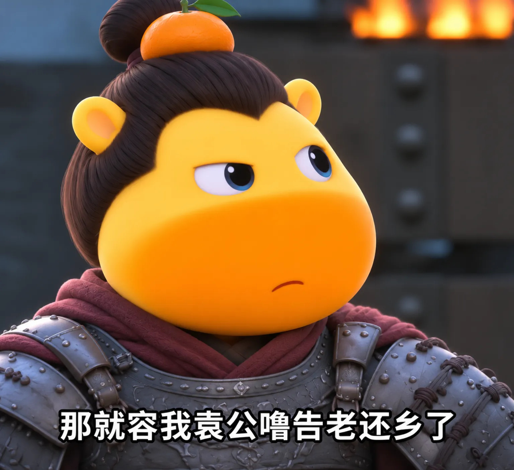 |

#### 邢道荣 → 邢道噜 · Xing Daorong → Xing Dao Lu
**场景 / Scene:** 夸张张嘴喊话、深色铁盔甲和城墙背景，圆头短臂。 A loudly shouting pose, iron helmet and courtyard backdrop, with a large head and short arms.  **字幕 / Caption:** `我乃是零陵上将军邢道噜`

| 原图 · Original frame | 噜噜转换 · Lulu result |
|:---:|:---:|
| 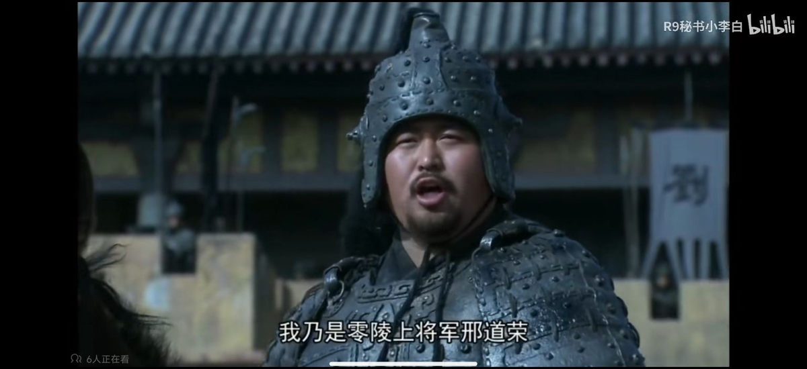 | 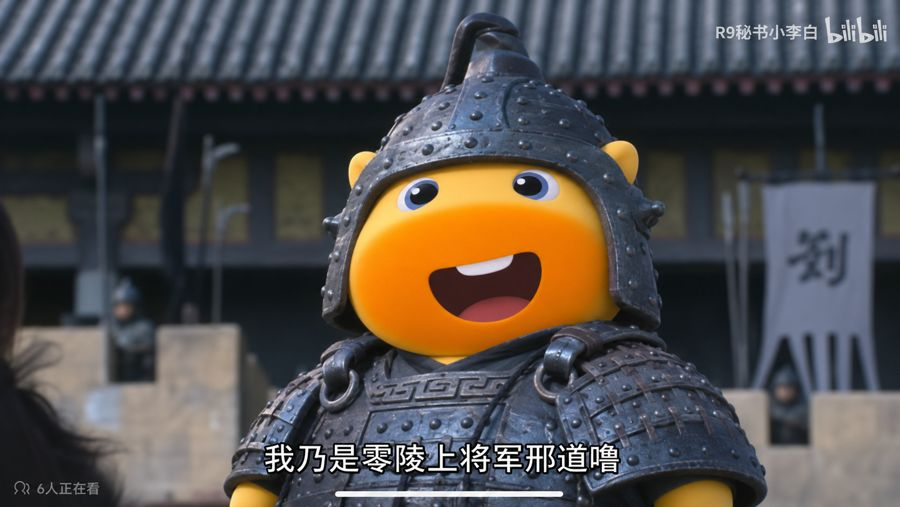 |

#### 《三国》群像海报 → 噜噜版《三国》海报 · Three Kingdoms ensemble poster → Lulu Three Kingdoms poster
**场景 / Scene:** 多角色海报、服饰差异、史诗群像、书法金字和战场背景。 A many-character ensemble, distinctive historical costumes, golden title and battlefield composition.  **字幕 / Caption:** `三国 / THREE KINGDOMS`

| 原图 · Original frame | 噜噜转换 · Lulu result |
|:---:|:---:|
| 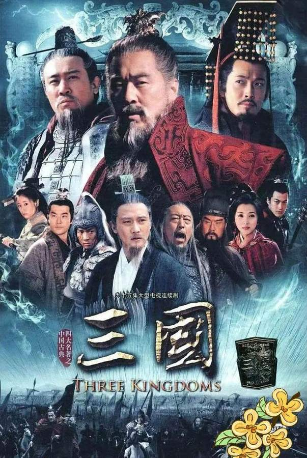 | 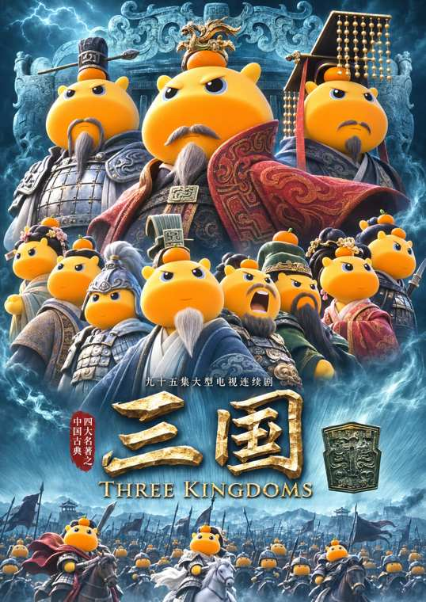 |

#### 公孙瓒 → 公孙瓒·噜噜版 · Gongsun Zan → Gongsun Zan as Lulu
**场景 / Scene:** 公孙瓒大笑特写，头盔和银色雕花肩甲保留，眼睛眯起。 Gongsun Zan laughing in close-up with a decorated helmet and silver engraved shoulder armor.  **字幕 / Caption:** `吃什么 是啊 是啊`

| 原图 · Original frame | 噜噜转换 · Lulu result |
|:---:|:---:|
| 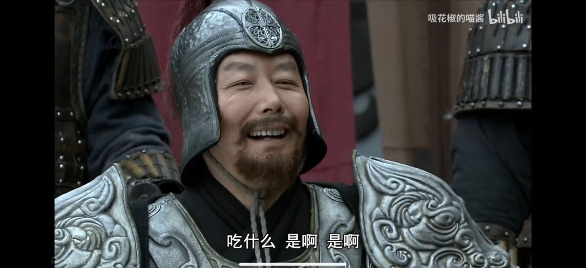 |  |

#### 孙策 → 孙策·噜噜版 · Sun Ce → Sun Ce as Lulu
**场景 / Scene:** 孙策双手托起玉玺的场景，保留银盔、白色披风及惊喜神态。 Sun Ce presenting a jade imperial seal with both hands, helmet and pale cloak intact.  **字幕 / Caption:** `恭喜爹可以称帝了`

| 原图 · Original frame | 噜噜转换 · Lulu result |
|:---:|:---:|
| 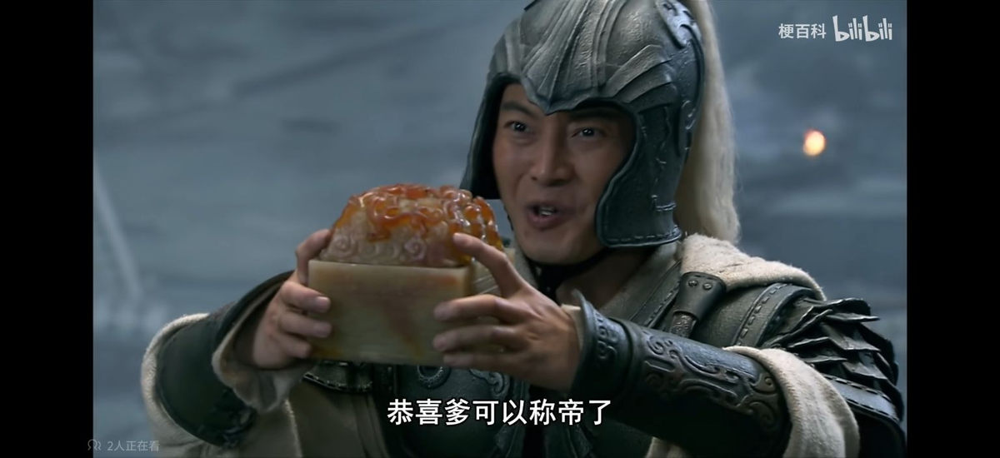 | 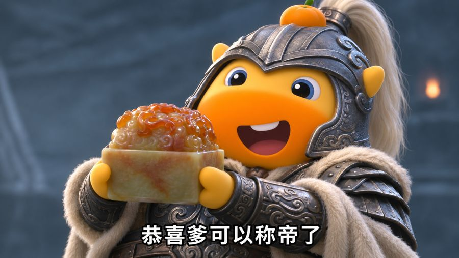 |

